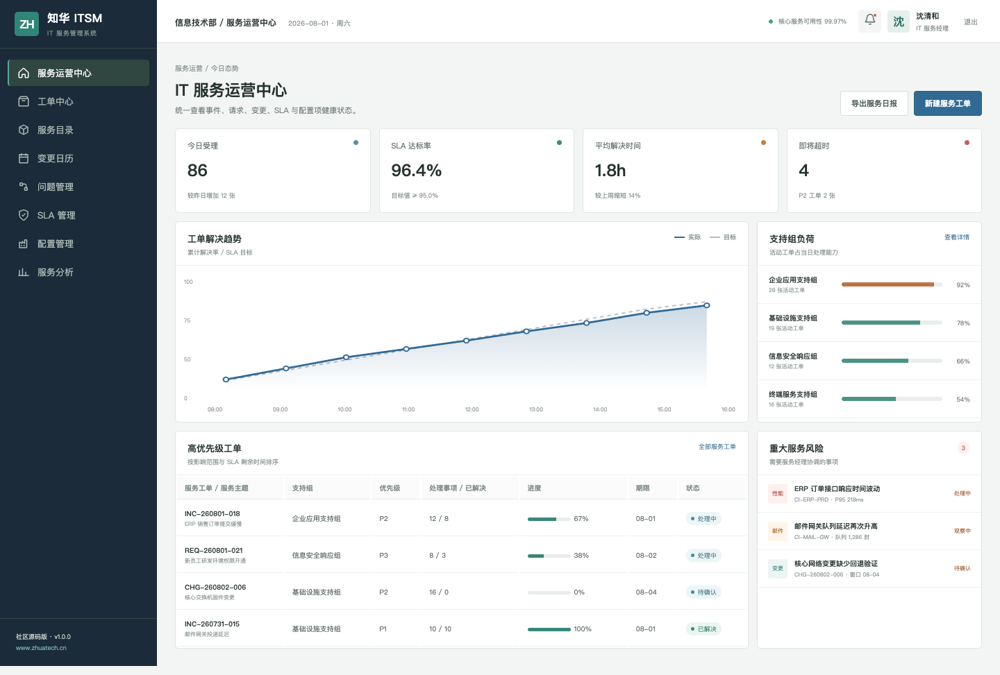
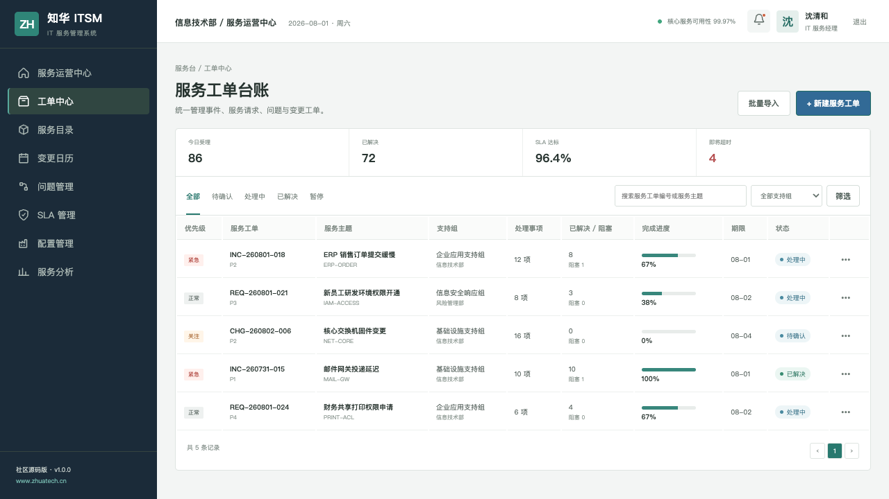
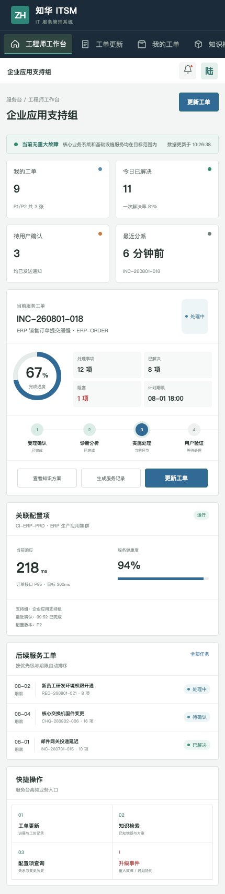

[简体中文](README.md) | **English**

## 2026-10-23 update: Service dependency blast radius

Traverses declared service dependencies from failed services to dependent consumers, retaining shortest evidence paths and critical-business flags without changing CMDB records.

After signing in to the real backend, open the bottom-right business calculation tool to submit structured input, inspect calculated results and export complete JSON. The endpoint is `POST /api/workbench/service-blast-radius` with the existing JWT. Computation is implemented server-side; it does not query another user's records, persist business documents, approve transactions or invoke external models. See [algorithm, sample and test notes](docs/AI_WORKFLOW_UPGRADE_20261023.md).

# ZhuaTech IT Service Management

> A source-available enterprise project by [ZhuaTech](https://www.zhuatech.cn/) for enterprise collaboration, workflow, governance, and service delivery.

ZhuaTech IT Service Management provides a practical, self-hosted foundation for enterprise collaboration, workflow, governance, and service delivery. It is designed for business users, process owners, approvers, service teams, and administrators, with clear business records, controlled workflows, operational visibility, and auditable actions.

This repository is intended for learning, technical evaluation, and non-commercial collaboration. The included implementation, tests, database resources, and container configuration provide a reproducible starting point for further enterprise adaptation.

**Search topics:** enterprise it service management, self-hosted it service management, Java Spring Boot enterprise software, digital transformation.


## Update: Response and resolution SLA pause accounting

This release adds an authenticated, structured batch workspace at `/operations.html`, backed by project-specific deterministic calculations, explicit validation, explainable decisions, and CSV/JSON exports. Decimal values are preserved exactly; no external model call is made.

Results are **read-only decision support**, not approvals or posted transactions. The feature does not send payments, sign contracts, destroy records, or control devices, and does not certify the whole application for production. See [the calculation contract and API guide](docs/OPERATIONS-REVIEW.md).
## Product Scope

- **Primary users:** Business users, process owners, approvers, service teams, and administrators.
- **Deployment model:** Self-hosted, with container-based local deployment where supported.
- **Governance baseline:** Role-aware operations, validation, approval boundaries, exception handling, and auditability.
- **Production boundary:** Review security, identity, backup, observability, capacity, and compliance controls before production use.

## Capability Map

- **Deep Ci** — Manage deep ci with ownership, validation, and explicit lifecycle states.
- **Deep Incident** — Coordinate deep incident through controlled workflows and approval gates.
- **Deep Problem** — Track deep problem metrics, exceptions, deadlines, and follow-up actions.
- **Deep Change** — Preserve deep change evidence in searchable, traceable operational history.
- **Deep Audit** — Expose deep audit in role-aware user and administration workspaces.
- **Support Group** — Connect support group to external systems through configurable integration boundaries.

## Technology Baseline

**Technology stack:** Java 21 · Spring Boot · Vue 3 · Vite · MySQL 8 · Docker Compose

### Repository Layout

- `backend/` — Java backend, domain services, APIs, validation, and automated tests
- `frontend/` — responsive user and administration interfaces
- `deploy/` — deployment and operations resources
- `docs/` — architecture, operations, screenshots, and supporting documentation
- `compose.yaml` — local multi-service orchestration

## Run Locally

```bash
docker compose up -d --build
```

- Review `compose.yaml` before changing published ports, storage paths, or production credentials.

## Verification

Run the checks supported by this repository before changing or deploying it:

```bash
cd backend && mvn test
cd frontend && npm ci && npm run build
```

## Interface Preview

### Itsm Service Operations



### Itsm Ticket Center



### Itsm Agent Workbench



## Security and Production Readiness

- Never commit real passwords, API keys, tokens, certificates, customer data, or production connection strings.
- Replace all local demonstration credentials and secrets before deployment.
- Apply least privilege, tenant isolation, backup and restore drills, monitoring, rate limiting, and vulnerability management.
- Please report security issues privately through the contact channels below instead of publishing sensitive details.

## Usage and Commercial Licensing

Copyright © 2026 Shanghai Rujing Zhihua Information Technology Co., Ltd.

This project is a publicly available source edition intended solely for personal learning, technical research, and non-commercial communication. Commercial use, paid delivery, resale, hosted commercial services, and commercial derivative distribution require prior written authorization from the copyright holder.

Third-party dependencies remain subject to their respective licenses. Review the repository `LICENSE` and `NOTICE` files before use.

## Commercial Licensing and Enterprise Services

For commercial licensing, private deployment, enterprise customization, software outsourcing, implementation services, FDE outsourcing, OPC technical support, or AI transformation consulting, contact ZhuaTech:

- Email: [han@zhuatech.cn](mailto:han@zhuatech.cn)
- Email: [jack@zhuatech.cn](mailto:jack@zhuatech.cn)
- [WhatsApp: +86 17521234993](https://wa.me/8617521234993)
- Website: [https://www.zhuatech.cn/](https://www.zhuatech.cn/)

## About ZhuaTech

[ZhuaTech](https://www.zhuatech.cn/) is operated by Shanghai Rujing Zhihua Information Technology Co., Ltd. We support small and medium-sized enterprises with digital transformation, AI adoption, enterprise software implementation, custom development, software project outsourcing, FDE services, OPC integration, and long-term technical support.
